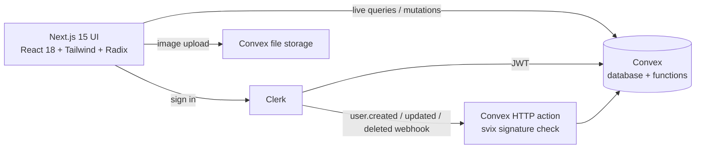

# Discordish

**A real-time Discord-style chat app: friends, direct messages, and servers with channels, roles and invite codes.** Built with Next.js, Convex and Clerk.

[](https://github.com/hewansirak/Discordish-Clone/actions)


[Watch the demo video](demo.mp4) · **Live demo:** _add your Vercel URL here after deploying_

## Features

**Friends**
- Send, accept, reject and cancel friend requests; unfriend. Only the recipient can answer a request, duplicates are blocked, and mutual requests auto-accept.
- Real online status (heartbeat based) visible to friends only.

**Direct messages** (friends only)
- Real-time messaging with image attachments.
- Reply to a message, edit your own messages, emoji reactions.
- Unread counts per conversation, typing indicators, full-text search in a conversation.
- Infinite history: messages load in pages.

**Servers**
- Create a server (it starts with `#general`), invite people with a shareable code, leave or delete.
- Channels: create, rename and delete (admins and owner). Channel chat with image attachments, editing, and moderator deletion.
- Roles: owner, admin, member. Owners promote and demote admins; admins and owners remove members below their rank.
- Member list with online status.

**Under the hood**
- Every Convex query and mutation checks membership and role on the server; the UI never decides what is allowed.
- 66 backend tests run against an in-memory Convex (`convex-test`), covering permissions, edge cases and regressions.

## Architecture



Data model: `users`, `friends`, `directMessages` + `directMessageMembers`, `messages`, `reactions`, `typingIndicators`, `presence`, `servers`, `serverMembers`, `channels`, `channelMessages`.

## Tech stack

Next.js 15 (App Router), TypeScript, Tailwind CSS, Radix UI / shadcn components, Convex, Clerk, Vitest + convex-test, GitHub Actions.

## Setup

```bash
git clone https://github.com/hewansirak/Discordish-Clone && cd Discordish-Clone
npm install
cp .env.example .env.local        # fill in the Clerk keys
npx convex dev                    # creates a deployment and fills NEXT_PUBLIC_CONVEX_URL
npm run dev
```

One-time Clerk + Convex wiring:

1. In Clerk, create an application and enable usernames. Under **JWT templates** add the **Convex** template.
2. In the Convex dashboard (Settings → Environment Variables) set `CLERK_JWT_ISSUER_DOMAIN` to the issuer shown in that template.
3. In Clerk → **Webhooks**, add an endpoint `https://<your-deployment>.convex.site/clerk-webhook` for `user.created`, `user.updated` and `user.deleted`, and set the signing secret as `CLERK_WEBHOOK_SECRET` in Convex.
4. Optional: set `SEED_DEMO_DATA=true` in Convex so new users get sample friends and conversations for demos.

## Scripts

| Command | What it does |
|---|---|
| `npm run dev` | Next.js and Convex dev servers |
| `npm test` | Backend tests (Vitest + convex-test) |
| `npm run typecheck` | Type-check the app and the Convex functions |
| `npm run lint` | ESLint |
| `npm run build` | Production build |

## Roadmap

- [ ] Voice and video channels
- [ ] Group direct messages
- [ ] Reactions, replies and typing indicators in server channels
- [ ] Message pinning and notifications
- [ ] Per-channel permissions

## References

- [Convex docs](https://docs.convex.dev) · [Convex + Clerk](https://docs.convex.dev/auth/clerk) · [Clerk webhooks](https://clerk.com/docs/integrations/webhooks/sync-data)

## License

MIT
